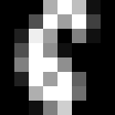

# Image Classification with Deep Learning

A compact PyTorch CNN recognizes one handwritten digit, from 0 through 9. The included model classified **268 of 269 held-out images correctly (99.63%)**. The one error was a handwritten 1 classified as a 7.

## Try the trained model

Run these commands from the project directory with Python 3.13.

```sh
python3.13 -m venv .venv
source .venv/bin/activate
python -m pip install -r requirements.txt
python -m digits predict examples/digit-6.png
```



The sample is image 492 in the dataset. The command predicts **6** and prints the three highest softmax scores. For your own image, crop closely around one digit and keep it upright. Light strokes on a dark background work by default. For dark handwriting on light paper, run `python -m digits predict your-digit.png --dark-ink`. The loader converts the image to grayscale, fits it into an 8 × 8 square while preserving aspect ratio, and applies the training normalization.

## Training and evaluation

### Predict a batch of images

For a mix of light and dark backgrounds, use `--auto-ink`. Use `--trim` if there is empty space around a digit. Each input file should contain one digit. The JSON output preserves the order of the files and includes the predicted digit and its ranked probabilities.

```sh
python -m digits predict examples/*.png --auto-ink --top-k 3 --json runs/predictions.json
```

### Reproduce the reference run

```sh
python -m digits train --output runs/retrained.pt
python -m digits evaluate --checkpoint runs/retrained.pt --split validation
python -m digits evaluate --checkpoint runs/retrained.pt --split test --json runs/test.json
python -m digits benchmark --checkpoint runs/retrained.pt --json runs/benchmark.json
```

The commands use one CPU thread by default. Each accepts `--help` for options. Evaluation, prediction, and benchmarking load the included [checkpoint](artifacts/digits.pt) by default.

Training saves each new best epoch atomically. If training stops midway, the last saved improvement is available for inference. Use a separate `--output` path for each experiment. To compare learning rates, pass `--learning-rate` and keep the seed fixed. Evaluation reports list each error's dataset index, actual digit, predicted digit, and probability assigned to the prediction. Pass `--json -` to stream a report into another program.

### Data and model

1. Load 1,797 grayscale, 8 × 8 images from scikit-learn's bundled handwritten digits dataset. NumPy shuffles each class with seed 42 and assigns 1,259 images to training, 269 to validation, and 269 to testing. The split is by image. This experiment does not measure accuracy on an independent group of writers. [Dataset reference](https://scikit-learn.org/stable/modules/generated/sklearn.datasets.load_digits.html)
2. Scale intensities from 0–16 to 0–1. Compute the mean and standard deviation on the training pixels and reuse both for validation, testing, and prediction. During training, independently rotate each digit by up to 10 degrees and translate it by up to 0.48 pixels on each axis.
3. Train two 3 × 3 convolution blocks with 24 and 48 channels. Each uses batch normalization, ReLU, and 2 × 2 max pooling. A 64-unit hidden layer with 20% dropout feeds the 10-class output. The model has 23,730 trainable parameters.
4. Minimize cross-entropy with AdamW, an initial learning rate of 0.002, weight decay of 0.01, and batches of 64. Reduce the learning rate when validation loss plateaus. Keep the lowest-loss weights and stop after 10 consecutive epochs without an improvement, up to 100 epochs.

### Measured accuracy

| Split | Correct | Accuracy | Macro F1 |
| --- | ---: | ---: | ---: |
| Validation | 269 / 269 | 100.00% | 1.0000 |
| Test | 268 / 269 | 99.63% | 0.9963 |

Training stopped at epoch 52 and selected epoch 42. The checkpoint includes its weights, split indices, dataset fingerprint, normalization statistics, run configuration, package versions, and per-epoch history. Evaluation verifies the dataset fingerprint before using the saved indices. Both reports include precision, recall, F1, support per digit, and a confusion matrix with true digits in rows and predictions in columns. [Validation report](artifacts/validation.json) · [Test report](artifacts/test.json)

### Measured CPU performance

| Measurement | Reference | Optimized |
| --- | ---: | ---: |
| Training throughput | 3,409 images/s at batch size 1 | 34,444 images/s at batch size 64 |
| Single-image forward pass, median | 0.0455 ms | 0.0386 ms |
| Single-image forward pass, 95th percentile | 0.0501 ms | 0.0439 ms |

These measurements used Python 3.13.12 and PyTorch 2.15.0 on an arm64 Mac with one PyTorch CPU thread. The benchmark runs 10 warm-up iterations and 200 timed iterations per configuration. Training measures in-memory batches through augmentation, normalization, forward pass, backward pass, and optimizer update.

For inference, the predictor folds each batch normalization layer into its preceding convolution and runs under `torch.inference_mode()`. The latency figures time one forward pass on an already-normalized image with the model in memory. The benchmark checks the fused model's class choices and scores against the original on 64 images before timing. [Benchmark report](artifacts/benchmark.json)

## Run the checks

```sh
python -m unittest discover -s tests -v
```

The suite checks partition integrity, image preprocessing, deterministic training, interrupted writes, early stopping, checkpoint compatibility, command-line prediction, evaluation totals, and benchmark output. A full retraining run with seed 42 on the reference environment reproduced every tensor in the shipped model.

## Deploy the web app

The browser app in `web/` includes the trained model, a touch-enabled drawing canvas, local image upload, ten held-out samples, and ranked predictions. All inference runs on the visitor's device.

**Local preview** — run `python3 -m http.server 8000 --directory web` from the repository root and open `http://localhost:8000`.

**Static hosting** — connect this repository to a static host, leave the build command empty, and set the publish directory to `web`. For a manual deployment, upload the contents of `web/` together. The entry point is `index.html`. The files use relative URLs and can also be served under a subdirectory.

**Updating the model** — after retraining, run `python -m digits.export_web --checkpoint runs/retrained.pt` and redeploy the updated `web/model.json`. The displayed accuracy describes the included checkpoint. Reevaluate replacement weights and update the displayed metric before publishing them.

### Checking browser accuracy

The upload path estimates the paper color at the image border, extracts the stroke and stretches its contrast. To measure the effect, the following experiment renders all 269 validation digits on each of three synthetic backgrounds. Both versions receive the same known crop. This isolates grayscale conversion from image decoding, cropping and resizing.

| Paper / ink intensity (0–255) | Original conversion | Updated conversion |
| --- | ---: | ---: |
| White / black (255 / 0) | 269 / 269 | 269 / 269 |
| Light gray / darker pencil (205 / 165) | 51 / 269 | 269 / 269 |
| Dark gray / lighter ink (55 / 95) | 49 / 269 | 269 / 269 |

These figures apply to the simulated contrast conditions. Accuracy on camera photos and independent writers remains unmeasured. The original test split still scores 268 / 269.

With the Python dependencies installed and Node.js available, run the following from the repository root.

```sh
python -m scripts.check_upload_accuracy
node --test tests/*.test.mjs
python -m unittest discover -s tests -v
```

The Python suite compares the shipped JavaScript model's probabilities with PyTorch on every held-out test digit when Node.js is available.
